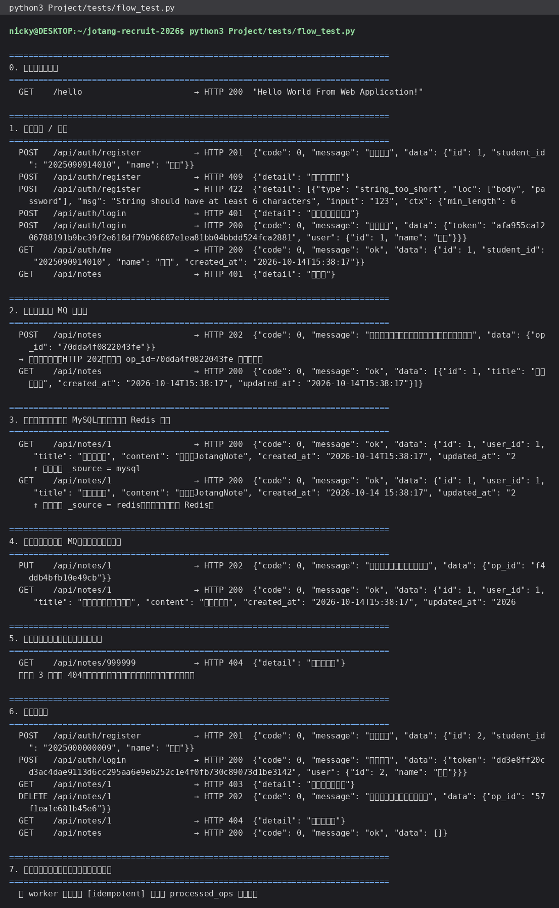

# 入门篇 01 · MySQL 实践：笔记增删改查 + 用户注册登录

> 这一节记录的是 `JotangNote` 里最基础的两块：**笔记的 CRUD** 和 **用户的注册 / 登录**。

## 一、环境与库表

- MySQL：WSL2 Ubuntu 里装的 `mysql-server 8.4.11`。
  因为本机（WSL 的镜像网络）里 Windows 侧的 MySQL 已经占了 3306，我把这台换到 **3307**：

  ```ini
  # /etc/mysql/mysql.conf.d/zz-port.cnf
  [mysqld]
  port = 3307
  mysqlx_port = 33070
  ```

- 建库建用户（密码不放代码里，走环境变量）：

  ```sql
  CREATE DATABASE jotangnote CHARACTER SET utf8mb4 COLLATE utf8mb4_unicode_ci;
  CREATE USER 'jotang'@'127.0.0.1' IDENTIFIED BY '******';
  GRANT ALL PRIVILEGES ON jotangnote.* TO 'jotang'@'127.0.0.1';
  ```

- 两张核心表（DDL 在 `Project/src/db.py` 的 `SCHEMA` 里，服务启动时幂等执行）：

  | 表 | 关键列 | 说明 |
  | --- | --- | --- |
  | `users` | `id` / `student_id`(唯一) / `name` / `password_hash` / `salt` | 密码只存 **PBKDF2 哈希 + 每用户独立盐**，不存明文 |
  | `notes` | `id` / `user_id` / `title` / `content` / `created_at` / `updated_at` / `deleted_at` | `deleted_at` 为空表示未删除（**软删除**） |
  | `processed_ops` | `op_id`(主键) / `note_id` / `op` | 给 MQ 消息做**幂等**用（见第 3 节） |

  索引：`notes` 上建了 `(user_id, deleted_at)` 和 `(created_at)`，
  前者服务“查我的笔记列表”，后者服务按时间排序。

## 二、功能使用流程（含截图）

完整链路（脚本 `Project/tests/flow_test.py` 一次跑完，输出见下图）：

1. **注册** `POST /api/auth/register` → 201；
   重复学号 → **409**；密码不足 6 位 → **422**（框架校验）。
2. **登录** `POST /api/auth/login` → 200 返回 `token`（存 Redis，7 天有效）；
   密码错误 → **401**。
3. **查自己** `GET /api/auth/me` → 200。
4. 不带 token 访问 `GET /api/notes` → **401**。
5. **新增笔记** `POST /api/notes` → **202**（立即返回，真正的写库由 MQ 消费者完成）。
6. **查列表** `GET /api/notes`、**查详情** `GET /api/notes/1`。
7. **改笔记** `PUT /api/notes/1` → 202；稍后查详情能看到新内容。
8. **删笔记** `DELETE /api/notes/1` → 202；之后查详情 → **404**，列表为空。
9. **越权测试**：用另一个账号查别人的笔记 → **403**。



服务起来以后打开 `http://localhost:8080/docs` 还能看到 FastAPI 自动生成的接口文档（截图）：


## 三、核心逻辑说明

### 1. 密码怎么存（`security.py`）

```python
def hash_password(password: str, salt: str) -> str:
    dk = hashlib.pbkdf2_hmac("sha256", password.encode(), salt.encode(), 200_000)
    return dk.hex()

def verify_password(password, salt, expected_hash) -> bool:
    return hmac.compare_digest(hash_password(password, salt), expected_hash)
```

- **每个用户一个随机盐**：同样密码的两个用户，哈希值也不同（防彩虹表）。
- **20 万次迭代**：让暴力破解的每一次尝试都变慢。
- **`compare_digest`**：定长比较，避免通过响应时间推测密码。
- 数据库里**没有明文密码**，`salt` 和 `password_hash` 分开存。

### 2. 登录态怎么管（`cache.py`）

登录成功后生成 32 字节随机 token，把它作为 Redis 的 key（value 是 user_id，带 7 天过期）：

```python
cache.save_session(token, user_id)
user_id = cache.get_session_user(token)     # 每个请求用它鉴权
```

好处：**服务端能主动失效**（退出登录直接删 key），也不像 JWT 那样“签发后无法撤销”。
代价是多一次 Redis 查询（微秒级，可以接受）。

### 3. 增删改的真身（`db.py`）

全部走**参数化 SQL**：

```python
db.execute_returning_id(
    "INSERT INTO notes (user_id, title, content) VALUES (%s, %s, %s)",
    (user_id, title, content),
)
```

用 `%s` 占位 + 参数元组，而不是 f-string 拼字符串——否则标题里写个 `'; DROP TABLE notes; --`
就可能把表干掉（SQL 注入）。

### 4. 连接池

`db.py` 用 `DBUtils.PooledDB` 包住 pymysql：进程启动时建一个连接池，
每个请求借一条连接、用完归还。这样高并发时不会因为反复建立 TCP + 认证而拖慢。

## 四、测试过程与结果

| 用例 | 期望 | 实际 |
| --- | --- | --- |
| 注册新学号 | 201 | 201 ✅ |
| 重复注册同一学号 | 409 | 409 ✅ |
| 密码长度 3 位 | 422 | 422 ✅（Pydantic 校验） |
| 密码错误登录 | 401 | 401 ✅ |
| 未带 token 访问 | 401 | 401 ✅ |
| 新增笔记 | 202 + op_id | 202 ✅ |
| 查别人的笔记 | 403 | 403 ✅ |
| 删除后查询 | 404 | 404 ✅ |

数据核对（MySQL 里直接查）：

```bash
$ mysql -h127.0.0.1 -P3307 -ujotang -p jotangnote -e "SELECT id,student_id,name FROM users; SELECT id,title,deleted_at FROM notes;"
```

> 🤖 AI 使用说明：本节代码与文档由本人使用 Hermes Agent 协助完成，所有接口、截图与表格中的结果
> 均为本地实际运行所得（截图来自 `Project/tests/flow_test.py` 的真实输出）。
