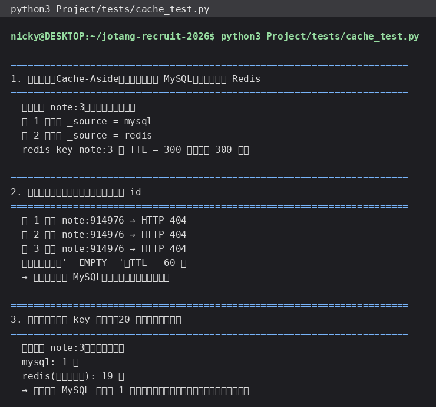

# 入门篇 02 · Redis 实践：给笔记查询加缓存（含防穿透 / 防击穿）

> 这一节把「按 ID 查询笔记」这个接口从“每次都查 MySQL”改成“先查 Redis 缓存”。

## 一、改造后的流程

```text
       请求 GET /api/notes/{id}
                │
                ▼
        ┌── 查 Redis 缓存 ──┐
        │                    │
     命中                  未命中
        │                    │
        │                    ├─ 抢互斥锁 SETNX lock:note:{id}
        │                    │        │
        │                    │      抢到 ──→ 查 MySQL ──→ 回填缓存 → 返回
        │                    │        │                 └─（查不到 → 写空值标记 __EMPTY__）
        │                    │      没抢到 ──→ 等别人重建好 → 读缓存返回
        ▼                    ▼
     直接返回（_source = redis）
```

- **命中**：直接返回，完全不碰 MySQL。
- **未命中**：回源 MySQL 并把结果写回缓存（Cache-Aside 模式）。
- **查不到**：写一个 60 秒的 `__EMPTY__` 标记，防止有人反复查不存在的笔记（**缓存穿透**）。
- **锁**：重建缓存时只有一个请求回源，其余等待后读缓存（**缓存击穿**）。

## 二、功能使用流程（含截图）

测试脚本 `Project/tests/cache_test.py` 一次演示三件事：

1. **缓存旁路**：清掉 `note:{id}` 后连续查两次 → 第一次 `_source = mysql`，第二次 `_source = redis`，
   并打印缓存的 TTL（300 秒）。
2. **缓存穿透**：连查三次一个不存在的 id → 三次都 404，
   但缓存里留下了 `note:{id} = "__EMPTY__"`（TTL 60 秒），后两次不再查 MySQL。
3. **缓存击穿**：清掉缓存后并发 20 个请求查同一篇笔记 → **只有 1 个请求回源 MySQL**，
   其余 19 个在等锁结束后直接读缓存。



## 三、核心逻辑说明

### 1. 缓存读写（`cache.py`）

```python
def note_key(note_id):  return f"note:{note_id}"

def get_cached_note(note_id):
    raw = client().get(note_key(note_id))
    if raw is None:      return False, None      # 真未命中
    if raw == "__EMPTY__": return True, None     # 命中的是「不存在」标记
    return True, json.loads(raw)

def set_cached_note(note_id, note):
    client().set(note_key(note_id), json.dumps(note, ensure_ascii=False, default=str),
                 ex=NOTE_CACHE_TTL)              # 一定要设过期时间
```

**key 设计**：`note:{id}`——业务前缀 + 标识，排查和批量清理都方便。
**value 设计**：整行序列化成 JSON 一次性存。查询接口拿到整行，这样最省往返。

### 2. 缓存一致性：写库后删缓存

MQ 消费者执行完增删改之后调用：

```python
cache.invalidate_note(note_id)     # DEL note:{id}
```

这里选择**删缓存**而不是**更新缓存**：删了以后下一次读会自然回填，
不会出现“两个并发写把缓存更新成旧值”的顺序问题（Cache-Aside 的标准做法）。

> 注意：本项目的写操作走 MQ 异步，所以“数据库改了”和“缓存删了”是同一个消费者里连续做的，
> 顺序有保证；如果是同步写库，也要保证“先改库、再删缓存”。

### 3. 防穿透：空值标记

```python
def set_empty_mark(note_id):
    client().set(note_key(note_id), "__EMPTY__", ex=EMPTY_CACHE_TTL)   # 60 秒
```

坏蛋用一个不存在的 id 疯狂查库时，第一次查库后会留下标记，后续请求直接命中标记返回 404。
**为什么要有过期时间**：万一那篇笔记后来真的被创建出来，标记很快失效，不会一直 404。

（更彻底的做法是布隆过滤器，把“一定不存在”的 id 直接挡掉，不占用 key 空间。）

### 4. 防击穿：互斥锁 + 短暂等待

```python
def acquire_rebuild_lock(note_id):
    return bool(client().set(f"lock:note:{note_id}", "1", nx=True, ex=LOCK_TTL))  # SET NX EX
```

- `nx=True` 保证只有一个请求能拿到锁（这就是 Redis 版的分布式锁最简单形态）；
- `ex=5` 秒：万一拿到锁的进程挂了，锁会自动过期，不会死锁；
- 没抢到锁的请求 `wait_for_cache()` 轮询等一下（最多 2 秒），等到就直接读缓存，等不到才自己回源。

效果就是上面截图里的 **1 次 MySQL + 19 次缓存**。

（另一种思路是“逻辑过期”：缓存里存过期时间但不真的删 key，重建由后台线程做，请求永远不等待。
适合对响应时间极敏感的场景。）

### 5. 顺便说一下 Redis 在项目里的第二个用途：登录会话

```python
cache.save_session(token, user_id)      # SET session:{token} → user_id EX 7天
user_id = cache.get_session_user(token) # 每个请求鉴权
```

好处是**服务端可主动失效**（退出登录直接 `DEL`）。

## 四、测试过程与结果

| 用例 | 期望 | 实际 |
| --- | --- | --- |
| 缓存未命中 → 查库 → 回填 | 第一次 `_source=mysql` | ✅ mysql |
| 再次查询 | 第二次 `_source=redis` | ✅ redis |
| 缓存 TTL | 300 秒 | ✅ 300 |
| 查不存在的笔记 3 次 | 3 次 404，且留下空标记 | ✅ `__EMPTY__`，TTL 60 |
| 20 并发查同一篇冷笔记 | 只有 1 次回源 | ✅ 1 次 mysql + 19 次 redis |
| 改笔记后缓存 | 缓存被删除、下次读回源 | ✅（见第 01 节流程测试第 4 步） |

用命令行直接看缓存内容：

```bash
$ redis-cli keys 'note:*'
1) "note:3"
2) "note:914976"
$ redis-cli ttl note:3
(integer) 300
$ redis-cli get note:914976
"__EMPTY__"
```

> 🤖 AI 使用说明：本节代码、缓存策略设计与文字说明由本人使用 Hermes Agent 协助完成；
> 上表中的所有结果与截图均来自本地真实运行（`Project/tests/cache_test.py`）。
