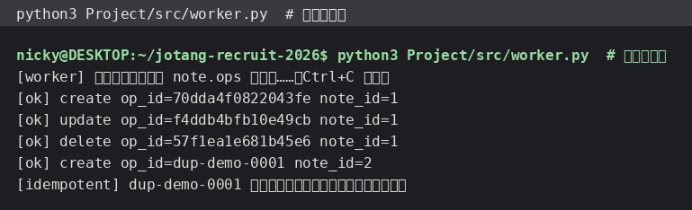
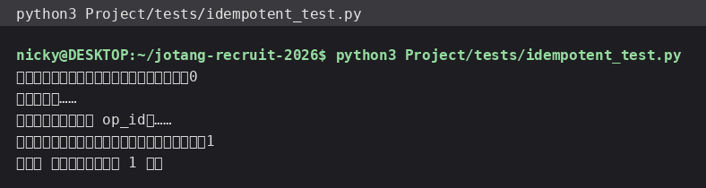

# 入门篇 03 · RabbitMQ 实践：把增删改丢进消息队列（含顺序性与幂等性）

> 这一节把笔记的**增 / 删 / 改**从“接口里同步写数据库”改成“投消息进 MQ，接口立即返回，
> 后台消费者慢慢执行”。

## 一、改造后的流程

```text
客户端 ── POST /api/notes ──► 接口只做两件事：
                              1. 把操作封装成消息（含唯一 op_id）
                              2. 投递到 RabbitMQ 队列 note.ops
                            ──► 立刻返回 202 Accepted（不等写库！）

                                 RabbitMQ（队列 note.ops，持久化）
                                        │
                                        ▼
                       消费者 worker.py 取消息 → 执行 SQL → 删缓存 → basic_ack
```

对比改造前：

| | 改造前（同步） | 改造后（异步） |
| --- | --- | --- |
| 接口耗时 | 等 SQL 执行完（写大笔记更慢） | 只等投递（毫秒级） |
| 接口返回码 | 201/200 | **202 Accepted**（受理，不一定已完成） |
| 失败处理 | 直接报错给用户 | 消息留在队列里，可重试 |
| 代价 | — | 用户看到的结果有延迟（最终一致） |

## 二、功能使用流程（含截图）

请求侧的流程（`Project/tests/flow_test.py` 第 2、4、6 节）：

1. `POST /api/notes` → **202** `{"op_id":"70dda4f0…"}`——消息已入队；
2. 稍等约 1 秒后再 `GET /api/notes`，笔记已经在了（消费者写完了）；
3. `PUT /api/notes/{id}` → 202，稍后查询能读到新内容；
4. `DELETE /api/notes/{id}` → 202，稍后查询变 404、列表变空。

消费者侧的真实日志（每一条消息一行，能看到 op 类型、op_id、写入的 note_id）：



幂等性验证（同一条消息投递两次）：日志里出现 `[idempotent] … 已处理过，跳过`，
数据库里只多出一篇笔记：



## 三、核心逻辑说明

### 1. 生产者（`mq.py`）

```python
ch.queue_declare(queue="note.ops", durable=True)          # 队列持久化
ch.basic_publish(
    exchange="", routing_key="note.ops",
    body=json.dumps(body, ensure_ascii=False).encode(),
    properties=pika.BasicProperties(delivery_mode=2, message_id=op_id),   # 消息持久化
)
```

消息体里带齐消费者需要的全部信息，消费者**不用回头查接口**：

```json
{"op_id":"70dda4f0822043fe","op":"create","note_id":null,"user_id":1,
 "title":"第一篇笔记","content":"你好，JotangNote","queued_at":"2026-10-14T15:36:42"}
```

`delivery_mode=2` + `durable=True` 表示：RabbitMQ 重启后队列和消息都还在。

### 2. 消费者（`worker.py`）

```python
ch.basic_qos(prefetch_count=1)      # 一次只领一条
ch.basic_consume(queue=QUEUE, on_message_callback=handle)

def handle(ch, method, properties, body):
    msg = json.loads(body)
    if already_processed(msg["op_id"]):
        ch.basic_ack(...); return                 # 幂等：重复消息直接确认掉
    note_id = apply_op(msg)                       # 真正写数据库
    mark_processed(msg["op_id"], note_id, msg["op"])
    cache.invalidate_note(note_id)                # 缓存失效
    ch.basic_ack(delivery_tag=method.delivery_tag)
```

几个关键点：

- **手动 ack**：只有执行成功才 `basic_ack`。若中途异常，消息不会被误删
  （这里用 `basic_nack(requeue=False)` 直接丢弃并打印错误，避免坏消息无限重投把队列堵死——
  生产环境应该配死信队列）。
- **prefetch=1**：消费者一次只拿一条，处理完再拿，多个消费者之间也能均衡分工。

### 3. 顺序性（加分项）

题面提醒过：“删除一篇笔记的操作不能先于修改到达”。本项目保证顺序的做法：

1. **单队列 + 单消费者 + prefetch=1**：消息按投递顺序一条条处理，天然有序；
2. **路由键用同一个**（`note.ops`），不用多个队列打散同一篇笔记的操作。

如果要多消费者并行还要保序，就得升级成“按笔记 ID 哈希路由到固定队列/固定分区”，
让同一个笔记的所有操作落在同一个消费者身上。

### 4. 幂等性（加分项）

网络抖动可能导致同一条消息被投递两次。消费者靠 `processed_ops` 表（`op_id` 是主键）判断：

```sql
INSERT INTO processed_ops (op_id, note_id, op) VALUES (%s, %s, %s);
```

- 第一次执行：插入成功 → 继续处理；
- 第二次执行：`op_id` 已存在 → 直接 `basic_ack` 跳过。

这就是幂等（“同一操作执行多次，结果和执行一次相同”）的最简单实现。
截图里的测试就是**故意把同一个 op_id 投递两次**，结果数据库里只有 1 篇笔记。

### 5. 为什么要先 `queue_declare` 再发消息

`queue_declare` 是**幂等**的：队列不存在就创建，存在就沿用。
生产者和消费者两边都声明一次，谁先启动都不会报错。

## 四、测试过程与结果

| 用例 | 期望 | 实际 |
| --- | --- | --- |
| 新增笔记 | HTTP 202 + op_id，接口不等待写库 | ✅ 202 |
| 稍后查询 | 笔记已落库 | ✅ 1 秒内可见 |
| 修改笔记 | 202，稍后内容更新 | ✅ |
| 删除笔记 | 202，稍后 404 | ✅ |
| 同一条消息投递两次 | 只写入 1 篇 | ✅ 幂等生效（日志有 `[idempotent]`） |
| 消费者异常 | 不无限重投 | ✅ 用 `basic_nack(requeue=False)` |

队列状态也可以用命令行看：

```bash
$ sudo rabbitmqctl list_queues name messages consumers
note.ops        0       1
$ sudo rabbitmqctl list_exchanges name type | head
```

（`messages=0` 说明消息都被消费掉了，`consumers=1` 是我们的 worker。）

> 🤖 AI 使用说明：本节代码与文字说明由本人使用 Hermes Agent 协助完成；
> 两张截图分别来自真实的 worker 运行日志和幂等性测试输出。
