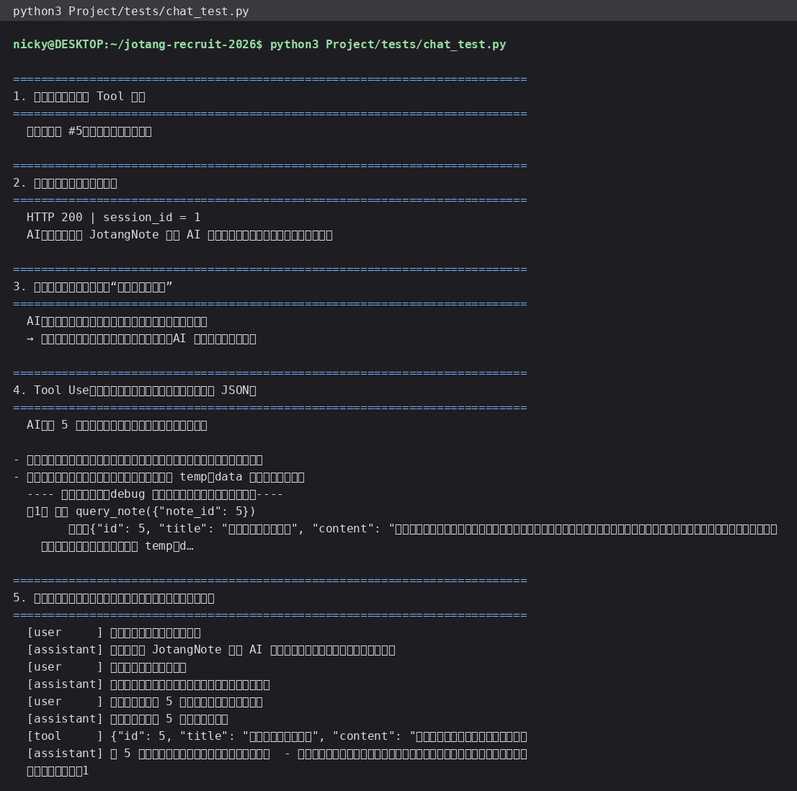

# 进阶篇 01 · 接入 AI 的 API 与会话管理

> 这一节做两件事：让 `JotangNote` 能跟 AI 对话（`/api/chat`），以及让 AI **记住上下文**（会话管理）。

## 一、动手之前：先想清楚每一步在干什么

题面提醒“先别急着写代码”。我先把流程拆成四步想清楚：

```text
1. 用户发一句话  →  我们的 /api/chat 收到
2. 我们把「系统提示 + 历史消息 + 这句话」打包成一个 messages 数组
3. 用 HTTP POST 发给 AI 服务（DeepSeek / MiMo 都是 OpenAI 兼容格式）
4. AI 返回 choices[0].message.content → 我们存进会话历史 → 返回给用户
```

关键理解：**AI 服务端是无状态的**。“记得之前聊过什么”完全是我们自己每次把历史一起发过去实现的。

## 二、AI 客户端（`Project/src/ai.py`）

```python
body = {
    "model": "deepseek-chat",
    "messages": messages,          # [{"role": "system"|"user"|"assistant", "content": "..."}]
    "temperature": 0.7,
    "max_tokens": 1024,
    "stream": False,
}
req = urllib.request.Request(f"{API_BASE}/chat/completions",
        data=json.dumps(body, ensure_ascii=False).encode(),
        headers={"Content-Type": "application/json", "Authorization": f"Bearer {API_KEY}"})
```

要点：

- **API key 只从环境变量读**（`JOTANG_AI_API_KEY`，没配就报 503），代码里不带任何密钥，
  仓库里也不会有——这是题面反复强调的。
- 模型名、接口地址都能用环境变量覆盖，所以想换成 MiMo 只要改 `JOTANG_AI_BASE` / `JOTANG_AI_MODEL`
  （它们都提供 OpenAI 兼容接口）。
- 用 `system` 消息交代**它是什么、要做什么、别编造**，这比在用户消息里嘱咐更稳。

## 三、会话管理（`Project/src/sessions.py`）

最简单的做法是题面说的“放内存 list”，但那样**进程一重启对话就没了**。
我把消息存进了 MySQL（顺便把 Bonus 的“会话持久化”做了）：

| 表 | 作用 |
| --- | --- |
| `chat_sessions` | 一个会话一行：属于谁、标题、创建/更新时间 |
| `chat_messages` | 一条消息一行：`role`（system/user/assistant/tool）、`content`、`raw`、`tool_call_id` |

两个设计细节值得说：

1. **`raw` 列保存完整的 assistant 消息**。模型要调用工具时，返回的消息里有 `tool_calls` 字段，
   这不属于 `content`。如果只存文本，下一次请求就还原不出“它上一轮要求调用哪个函数”，
   上下文会断，模型会重复调用或答非所问。
2. **只带最近 40 条消息进上下文**（`MAX_CONTEXT_MESSAGES`）。
   对话越长 token 越多、越贵也越容易超上下文窗口；先给一个上限，属于“能跑起来”的简化做法，
   更讲究的方案（摘要压缩、向量检索）见最后一节。

## 四、功能使用流程（含截图）

测试脚本 `Project/tests/chat_test.py` 的输出：

1. 第一句：“你好，请用一句话介绍你自己” → 正常回答，返回 `session_id`；
2. 第二句：“我刚才那句话说了什么？” → 它准确复述了第一句 —— **说明会话历史被带进上下文**；
3. 第三句让它总结一篇笔记 → 它先调用工具读笔记，再给出总结（下一节详述）。



前端页面里同样的能力（登录后在右侧直接聊，截图）：


## 五、测试过程与结果

| 用例 | 期望 | 实际 |
| --- | --- | --- |
| 发一句普通消息 | 200 + 回答 + session_id | ✅ |
| 同一会话追问上文 | 能复述上一句 | ✅ “你刚才说的是：「你好，请用一句话介绍你自己」” |
| 未配 API key | 503 | ✅（`ai.is_configured()` 提前判断） |
| 会话持久化 | 从数据库能读回完整历史 | ✅ 6 条消息按顺序读回（含 tool 消息） |
| 会话列表 | 只返回自己的会话 | ✅ |

历史可以从数据库直接查（不用猜）：

```bash
$ mysql -h127.0.0.1 -P3307 -ujotang -p jotangnote \
    -e "SELECT id,session_id,role,LEFT(IFNULL(content,raw),40) AS c FROM chat_messages ORDER BY id;"
```

## 六、还能做得更好的地方（我理解的取舍）

- **上下文管理**：现在是“截断最近 N 条”。更稳的是先做**摘要压缩**（把较早的对话总结成一段再带上），
  或者把历史做成**向量检索**，按相关度取回（RAG）。
  顺便说一句，Claude Code / Codex 这类 Agent 的做法就是“系统提示固定 + 关键信息落盘成文件（规则、TODO）+
  上下文快满时压缩”，思路和这里是一样的。
- **内存 vs 落库**：内存快，但重启即丢、多进程不共享；落库能扛重启，代价是每次多一次 SQL。
  本项目选了落库，因为“会话记录丢了”是很影响体验的事。
- **流式输出**：现在 `stream=False`，要打字机效果需要改成 SSE 或 WebSocket 逐块推给前端。

> 🤖 AI 使用说明：本节代码与文字由本人使用 Hermes Agent 协助完成，所有结果与截图均来自本地真实运行。
