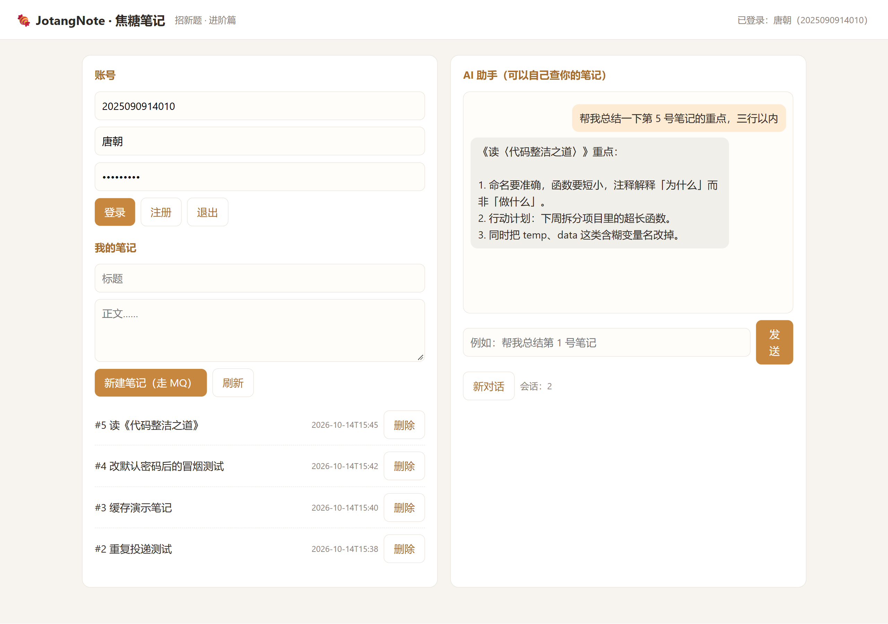

# 进阶篇 03 · 前端页面（Vibe Coding）

> 题目说：“从来没在浏览器上亲眼见过孩子一面的家长——多么让人遗憾”。
> 所以这一节给 `JotangNote` 补上一个能点的网页。

## 一、做法：让 AI Agent 直接写前端

我用的方式就是题面说的 **Vibe Coding**：把后端已有的接口清单交给 Agent（Hermes Agent），
让它写一个**单文件**的前端页面。我给它的要求是：

1. 一个文件就够（`Project/src/static/index.html`），不引外部依赖和构建工具；
2. 页面分左右两栏：左边账号 + 我的笔记，右边 AI 助手对话；
3. 后端接口已经定稿，按现有路径调用，不要改后端；
4. 登录态存 `localStorage`，刷新页面还在。

它产出的页面就是下面这张截图里的样子（焦糖色的配色、两栏布局）。

## 二、页面长什么样



页面上的每个操作其实都是调一个后端接口：

| 页面上的动作 | 调用的接口 |
| --- | --- |
| 登录 / 注册 / 退出 | `POST /api/auth/login`、`/register`、`/logout` |
| 顶部“已登录：xxx” | `GET /api/auth/me` |
| 笔记列表、删除按钮 | `GET /api/notes`、`DELETE /api/notes/{id}` |
| 新建笔记 | `POST /api/notes`（走 MQ，返回 202 后提示“稍后生效”） |
| 点标题看详情 | `GET /api/notes/{id}`（详情里会显示“数据来自 redis / mysql”） |
| 右侧跟 AI 聊天 | `POST /api/chat`（带 `session_id` 就是同一轮对话） |
| “新对话”按钮 | 清掉本地 `session_id`，下一次请求就开新会话 |

前端代码里最核心的就是一个 `api()` 小函数（统一的 fetch 封装 + 自动带 token）：

```javascript
async function api(method, path, body) {
  const headers = { "Content-Type": "application/json" };
  if (token) headers["Authorization"] = "Bearer " + token;
  const resp = await fetch(path, { method, headers, body: body ? JSON.stringify(body) : undefined });
  const data = await resp.json().catch(() => ({}));
  if (!resp.ok) throw new Error(data.detail ? JSON.stringify(data.detail) : "HTTP " + resp.status);
  return data;
}
```

后端的错误也能直接显示出来：比如没登录时返回 401，前端就把“未登录”弹成提示。

## 三、功能使用流程（含截图验证）

我是**用浏览器自动化真的点了一遍**，不是只贴代码：

1. 打开 `http://localhost:8080/ui`；
2. 填学号/密码点“登录” → 右上角变成「已登录：唐朝（2025090914010）」，左栏列出我的笔记；
3. 在右侧输入“帮我总结一下第 5 号笔记的重点，三行以内” → AI 回复（中间它自己调用了查询工具）；
4. 截图留证（就是上面那张）。

自动化脚本：`cdp_ui_shot.py`（在仓库外，通过 Edge 的调试端口驱动真实浏览器：
登录 → 等笔记列表 → 发一条对话 → 等回复 → 截图）。这份截图是**页面真实渲染**的结果。

## 四、测试过程与结果

| 用例 | 期望 | 实际 |
| --- | --- | --- |
| 打开 `/ui` | 200 且页面正常渲染 | ✅（截图即为证据） |
| 登录 | 右上角显示昵称学号 | ✅ 唐朝（2025090914010） |
| 笔记列表 | 显示我自己的笔记 | ✅ #2～#5 共 4 条 |
| 新建笔记 | 提示已提交（op_id），稍后出现在列表 | ✅ |
| 查看详情 | 显示正文，并标出数据来自 redis / mysql | ✅ |
| 与 AI 对话 | 显示用户消息 + AI 回答 | ✅ |
| 未登录直接操作 | 提示“请先登录” | ✅（前端先拦，后端也有 401） |

## 五、Bonus：我做了哪一个

题目 Bonus 里列了不少方向，我做了**会话记录持久化**：

- 会话与消息存在 MySQL（`chat_sessions` / `chat_messages`），**服务重启后对话历史还在**；
  重新进同一个 `session_id` 就能接着聊（`GET /api/chat/sessions` 能列出历史会话）。

明确没做的（诚实说明）：笔记评论、笔记导出、全文搜索、Docker 打包部署。
其中**全文搜索**我评估过：数据量小时用 MySQL 的 `FULLTEXT` 索引就够，
数据量大、要分词和相关性排序时才需要上 Elasticsearch——为了一个招新小项目引 ES 属于过度设计。

## 六、我的理解

- **前端只是后端接口的一层壳**：页面能做的事，`curl` 都能做；接口设计得清楚，前端就写得快。
- **Vibe Coding 也要人来把关**：Agent 写出来的页面我逐条对着接口核了一遍（比如它一开始把 202 当成完成提示，
  我改成“稍后生效”），不然用户会以为笔记已经写好了。
- **登录态放 localStorage 是够用的简法**：真正的项目要考虑 XSS（存 httpOnly Cookie）、
  刷新时过期处理、多标签页同步等。

> 🤖 AI 使用说明：本节前端页面由本人使用 Hermes Agent 做 Vibe Coding 生成，
> 我逐条核对了接口调用与文案；截图是用浏览器自动化对真实运行页面拍摄的。
